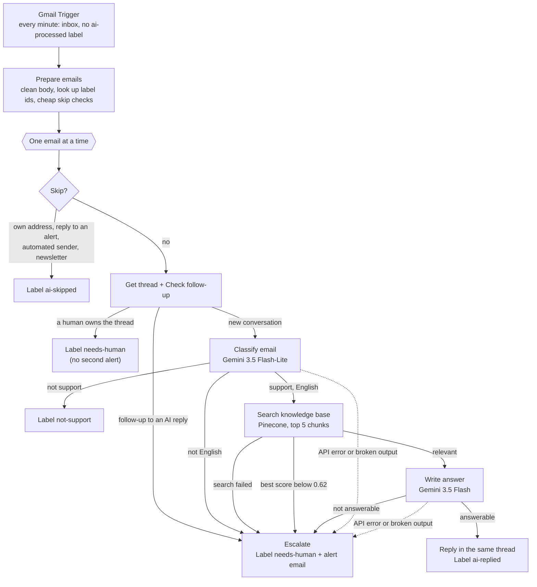
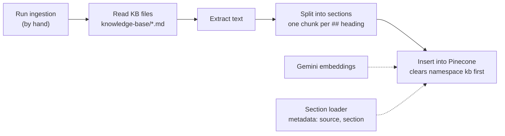

# Architecture

The project consists of three n8n workflows. They share one Gmail inbox, one Gemini API key and one Pinecone index.

| Workflow | Starts | Job |
|---|---|---|
| **Northwind – Support agent** | Every minute (Gmail polling) | Answers support emails from the knowledge base or escalates them |
| **Northwind – KB ingestion** | By hand | Loads `knowledge-base/*.md` into Pinecone |
| **Northwind – Error handler** | When one of the other two crashes | Emails an alert with the failed node and a link to the run |

There is no database. Each email's state is stored as Gmail labels, so the inbox itself shows what the agent did:

| Label | Meaning |
|---|---|
| `ai-replied` | The agent answered |
| `not-support` | Not a support request; no reply |
| `needs-human` | Escalated to a person |
| `ai-skipped` | Filtered out before any AI call |
| `ai-processed` | Added to every handled email; the trigger ignores emails that have it |

## Support agent

After every final step, control goes back to **One email at a time** for the next email of the same poll.

### Stage by stage

**1. Trigger and preparation**

| Node | What it does |
|---|---|
| Gmail Trigger | Polls every minute for inbox emails without `ai-processed`, read or unread. *Simplify* is off so all headers are available |
| Config | Agent address, alert address, relevance threshold. The only node to edit when setting up |
| Get Gmail labels | Reads the label list once per run, so the workflow can use label names instead of hard-coded ids |
| Prepare emails | One clean item per email: sender, subject, plain-text body (HTML converted, quoted messages and signatures removed, max 4,000 characters) and `skip_reason` |
| One email at a time | Loop Over Items with batch size 1. Keeps AI results matched to their email and spreads out Gemini calls |

**2. Cheap checks, no AI**

| Node | What it does |
|---|---|
| Skip? | Skips the agent's own emails, replies to `[needs-human]` / `[n8n error]` alerts, `noreply`-style senders and mailing lists |
| Get thread → Check follow-up | Gmail labels sit on single messages, so the whole thread is fetched to see whether an earlier message was already handled |
| Thread status | A human owns the thread → label only; follow-up to an AI reply → escalate as `follow_up`; otherwise → classify |

**3. Classification**

| Node | What it does |
|---|---|
| Classify email | LLM chain with a structured output parser. Returns `is_support`, `category`, `language`, `summary` and `question` (a short search query without the company name). The email is wrapped in `<email>` tags and treated as data, not instructions |
| Gemini (classify) / fallback | `gemini-3.5-flash-lite`, falling back to `gemini-3.5-flash` |
| Route classification | Not support → `not-support`; not English → escalate; otherwise → search |

**4. Retrieval**

| Node | What it does |
|---|---|
| Search knowledge base | Embeds `question` with `gemini-embedding-001` and returns the 5 closest chunks from the Pinecone namespace `kb` |
| Collect matches | Sorts the matches and keeps the top score. No matches means the search failed (see [error handling](#error-handling)) |
| Relevance check | Search failed → `api_error`; best score ≥ 0.62 → answer; otherwise → `low_relevance` |

**5. Answer**

| Node | What it does |
|---|---|
| Write answer | LLM chain returning `{answerable, answer}`. Rules: use only the excerpts, no partial answers, never promise refunds or discounts the excerpts don't state; a clear "no" from the excerpts counts as an answer |
| Gemini (answer) / fallback | `gemini-3.5-flash`, falling back to `gemini-3.5-flash-lite` |
| Answerable? | Answer → reply; otherwise → `insufficient_knowledge` |
| Reply to customer → Label: ai-replied | Gmail reply in the original thread, sent as "Northwind Coffee Support" |

**6. Escalation**

Every escalation goes through one **Escalate** node, which adds `needs-human` + `ai-processed` and sends an alert email. The alert contains the reason, sender, subject, category, summary, top relevance score, best match, error text and a link to the thread.

| Reason | When |
|---|---|
| `follow_up` | A new message in a thread the agent already answered |
| `unsupported_language` | The email isn't in English |
| `low_relevance` | The best knowledge base match scores below the threshold |
| `insufficient_knowledge` | The answer step found the excerpts don't fully answer the email |
| `classification_failed` / `answer_failed` | The model's output couldn't be parsed after 3 tries |
| `api_error` | Gemini or Pinecone failed after retries and fallbacks |

### Error handling

- **Retries:** every Gemini, Pinecone and Gmail node retries 3 times, 5 s apart. The customer reply is the exception: a retried send could reach the customer twice.
- **Fallback models:** both AI chains switch to a second Gemini model when the first fails. On the free tier each model has its own quota, so this also covers rate limits.
- **AI chains** report failures on their error output. Broken model output becomes `classification_failed` / `answer_failed`; anything else becomes `api_error`.
- **The knowledge base search** behaves differently: when a node crashes, n8n passes the input through unchanged instead of using the error output. A working search always returns matches, so **Collect matches** treats "no matches" as a failed search.
- **Anything unexpected** (a crash nothing handles) starts the **Error handler** workflow.

## Knowledge base ingestion

- **One chunk per `##` section**, with the document title and heading kept in the chunk text. Sections over 1,000 characters would be split at paragraph breaks; none currently are, so the 9 documents give 56 chunks.
- **Clear Namespace** runs before every insert, so re-running never creates duplicates.
- **The folder is mounted read-only** at `/home/node/.n8n-files/knowledge-base`. That's the only folder n8n reads files from by default.

## Error handler

**Error Trigger → Config → Send error alert.** The alert is an email titled `[n8n error] <workflow>`, with the failed node, the error message and a link to the failed run. It's set as the error workflow of the other two, and it must be published: n8n 2.x doesn't start unpublished error workflows, and doesn't start them for manual runs.

## Design decisions

- **A fixed pipeline instead of an AI Agent node.** Each step has one job and a defined output, so every email takes a path you can predict and test. An agent that decides when to search is harder to test and easier to talk into things.
- **Two layers decide whether the knowledge base covers a question.** Measured scores of covered and uncovered questions overlap (see [testing.md](testing.md#relevance-threshold)), so the threshold only removes clearly unrelated questions cheaply. The answer step makes the final call.
- **Cheap checks before AI.** Newsletters, the agent's own mail and follow-ups never reach Gemini.
- **Gmail labels as state.** No extra database, and a human can see and fix any email's state in Gmail.
- **Follow-ups go to a human.** Answering a follow-up safely needs the whole conversation, which is out of scope for v1.
